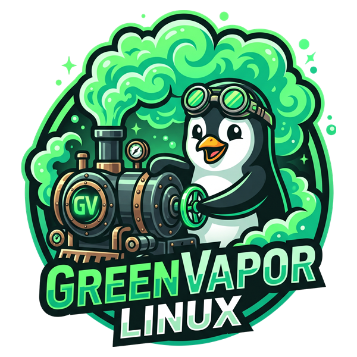
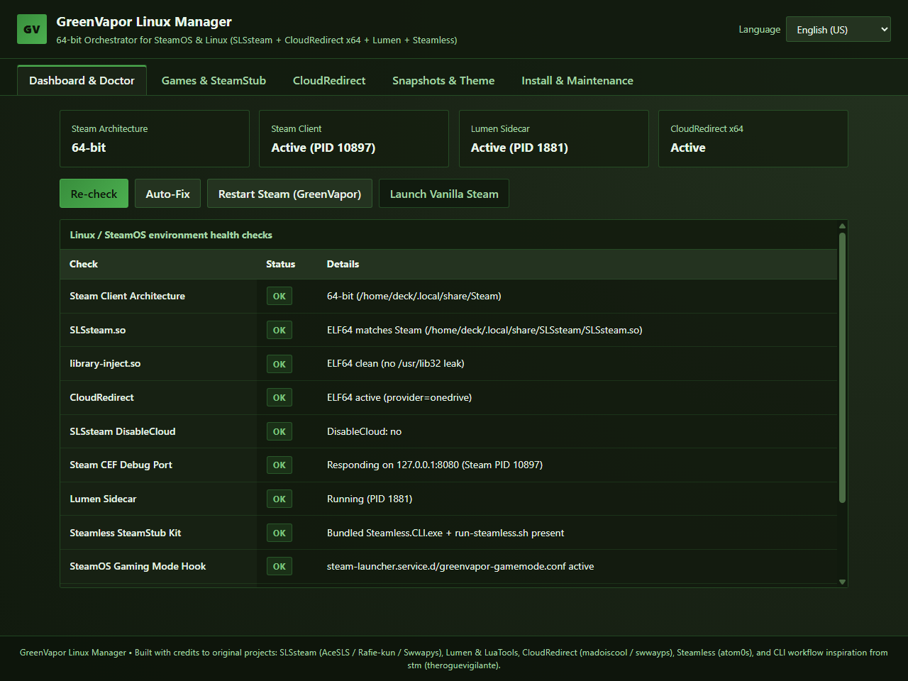
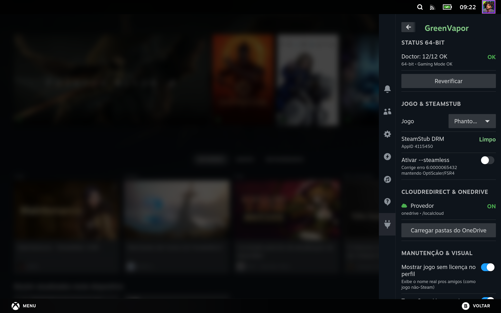

<div align="center">



# GreenVapor Linux Manager (`gvlinux`)

**Zero-root 64-bit & 32-bit orchestrator, diagnostics manager, and installer (CLI + WebUI + Decky QAM) for SteamOS, Legion Go, Steam Deck, Bazzite, CachyOS, and Linux.**

**English** | [Português (Brasil)](README.pt-BR.md) | [Screenshots](#screenshots) | [Quick Install](#quick-install-1-command--steamos--bazzite--linux) | [Live Coverage](#live-steam-signature-coverage-x64-primary--i386-supplementary) | [Commands](#key-commands) | [License](#license) | [Releases](https://github.com/vaporgreen/greenvapor-linux/releases/latest)

<br />

[](https://github.com/vaporgreen/greenvapor-linux/releases/latest)
[](https://github.com/vaporgreen/greenvapor-linux/releases)
[](https://github.com/vaporgreen/greenvapor-linux/actions/workflows/steam-signature-monitor.yml)
[](https://github.com/vaporgreen/greenvapor-linux/stargazers)
[](LICENSE)


</div>

---

## Screenshots

| Visual WebUI (`gvlinux gui`) | SteamOS Gaming Mode — Decky Loader QAM (`...`) |
| :---: | :---: |
|  |  |

---

## Quick Install (1 command — SteamOS / Bazzite / Linux)

```sh
curl -fsSL https://raw.githubusercontent.com/vaporgreen/greenvapor-linux/main/install.sh | sh
```

### Offline / Local Install (using files from `dist/`)

```sh
sh install.sh ./dist/gvlinux-linux-amd64 ./dist/greenvapor-linux-bundle-x64.tar.gz ./dist/greenvapor-base-stack.tar.gz
```

### Clean Uninstall (1 command — preserves games, saves & Lua scripts)

```sh
curl -fsSL https://raw.githubusercontent.com/vaporgreen/greenvapor-linux/main/uninstall.sh | sh
```

*(Also available via `gvlinux purge` or the **Uninstall / Purge** button inside `gvlinux gui`. Pass `--full` to also remove local snapshots in `~/.local/share/GreenVapor`.)*

### Optional: Decky Loader Plugin (Gaming Mode QAM `...`)

Download **`GreenVapor.zip`** from the [latest release](https://github.com/vaporgreen/greenvapor-linux/releases/latest) and install it via **Decky Loader → Developer → Install Plugin from ZIP** to manage `gvlinux` directly from Gaming Mode with a controller.

---

## Live Steam Signature Coverage (x64 Primary + i386 Supplementary)

Every 6 hours, [our CI monitor](.github/workflows/steam-signature-monitor.yml) downloads Valve's official live 64-bit (`steam_client_steamrt64` / `steam_client_publicbeta_steamrt64`) and 32-bit (`steam_client_ubuntu12` / `steam_client_publicbeta_ubuntu12`) manifests and validates every hook signature:

| Component | Steam Stable | Steam Public Beta | Upstream Status |
| --- | :---: | :---: | :---: |
| **`SLSsteam.so` x64** (`steamrt64`, primary) | **61 / 61** ✅ | **61 / 61** ✅ | 52/61 Stable · 41/61 Beta |
| **`cloud_redirect.so` x64** (`steamrt64`, primary) | **7 / 7** ✅ | **7 / 7** ✅ | N/A |
| **`SLSsteam.so` i386** (`ubuntu12_32`, supplementary) | **61 / 61** ✅ | **61 / 61** ✅ | 57/61 (4 `RunIPCFrame` drifted) |
| **`cloud_redirect.so` i386** (`ubuntu12_32`, supplementary) | **7 / 7** ✅ | **7 / 7** ✅ | 3/7 (`CProtoBufMsgBase` +8B shift) |

`install.sh` and `gvlinux update` automatically pick **`greenvapor-linux-bundle-x64.tar.gz`** on 64-bit `steamrt64` systems (SteamOS, Steam Deck, Legion Go, Bazzite, modern Linux) and **`greenvapor-linux-bundle-x86.tar.gz`** on legacy 32-bit (`ubuntu12_32` / hybrid `steamrt3`) clients. Patched with [patches/steam-beta-dual-patterns.patch](patches/steam-beta-dual-patterns.patch) and [patches/decky-cef-8080.patch](patches/decky-cef-8080.patch).

---

## What Is Included in the 64-bit Package

- **`gvlinux`** — static Go ELF64 binary (~6.5 MB, zero runtime dependencies, zero root):
  - **Visual WebUI (`gvlinux gui`)** with GreenVapor dark-green theme + automatic KDE/Desktop application shortcut.
  - **Multilingual (`en-US`, `pt-BR`, `es-ES`)** with automatic `$LANG` detection and live language switcher.
  - **Full 64-bit Diagnostics & Auto-Fix (`gvlinux doctor` / `gvlinux fix`)**:
    - 12 health checks validating `steamrt64` vs ELF64 across `SLSsteam.so`, `library-inject.so`, and `cloud_redirect.so`.
    - Detects the upstream `/usr/lib32` leak in 64-bit `library-inject.so`.
    - Detects & cleans legacy 32-bit `steam.cfg` (`BootStrapperInhibitAll=enable`) that causes SteamOS Gaming Mode `Updater check error: 40`.
    - Verifies `DisableCloud: no`, Steam CEF port, Lumen sidecar, Steamless kit, SteamOS Gaming Mode hook (`steam-launcher.service.d/greenvapor-gamemode.conf`), and Decky Loader + Lumen CEF port `8080` coexistence.
  - **Proton Launch Helper & Auto-Detector (`gvlinux proton` + WebUI)**:
    - Automatically scans installed games for local Wine-builtin proxy DLLs (`winmm.dll`, `version.dll`, `dxgi.dll`, `dinput8.dll`, `d3d12.dll`, etc.) sitting next to game executables without `WINEDLLOVERRIDES` and offers 1-click **Auto-Fix**.
    - Safe per-game **`WINEDLLOVERRIDES` manager** and **executable redirector** (skip launchers or pick an alternate subfolder `.exe` cleanly via `%command%`) while preserving `--steamless`, OptiScaler/FSR4, `MANGOHUD`, etc. Updates live via Steam CEF.
  - **Game & SteamStub v2/v3 Scanner (`gvlinux games` / `gvlinux steamless`)**: detects SteamStub-wrapped executables (e.g. `Application load error 6:0000065432`) and toggles `--steamless` without overwriting existing Launch Options.
  - **Configurable OneDrive Root Folder (`gvlinux cloud folders` / `gvlinux cloud set-folder <folder>`)**: choose `CloudRedirect`, `localcloud`, or any root folder on OneDrive where your Windows saves already live.
  - **Unowned Game Profile Presence (`gvlinux presence on|off`)**: optional toggle (`ShowUnownedStatus`) to display unowned games as non-Steam shortcuts on your Steam profile without breaking CloudRedirect.
  - **Snapshots, Rollback, `steam --vanilla`, SHA-256 Self-Updater (`gvlinux update`), and Clean `gvlinux purge --yes`** (never deletes your installed games or `stplug-in/*.lua` files).
  - **Reversible GreenVapor Theme for Lumen (`gvlinux brand apply|revert`)** preserving upstream community credits in the footer.

- **64-bit Payload Bundle (`greenvapor-linux-bundle-x64.tar.gz`)**:
  - **`cloud_redirect.so` + `cloud_redirect_cli` (x86_64)** — full 64-bit port for `steamclient64.so` with all 8 modules, configurable `onedrive_root_folder`, retry logic for OneDrive `curl 35/56` / `5xx` transient errors, and a 5-second burst cache window under `foreignSession`.
  - **`SLSsteam.so` (x86_64)** — built with dual Steam Stable + Public Beta signatures (`61/61`) and Decky Loader + Lumen CEF port `8080` coexistence across `pressure-vessel` and secondary `LD_AUDIT` namespaces.
  - **`library-inject.so` (x86_64)** — fixed ELF64 loader ([patches/library-inject-x64.cpp](patches/library-inject-x64.cpp)) validating `ELFCLASS64` headers so `/usr/lib32` never breaks `kde-open` / browser OAuth login.

---

## Key Commands

```sh
gvlinux gui                                 # Open the embedded visual WebUI in your browser
gvlinux doctor                              # Run full 64-bit/32-bit stack diagnostics (14 checks, emerald CLI)
gvlinux fix                                 # Safe auto-repair (Gaming Mode, Decky 8080, Updater 40, conflicts)
gvlinux cheevo                              # Generate missing local Steam Achievement Schemas (zero API key)
gvlinux catalog search "Deadpool"           # Search Steam Store + delisted/removed games by name or AppID
gvlinux catalog add 224060                  # Add a game by AppID via your local Lumen/LuaTools sources
gvlinux saves backup <appid>                # Backup Proton prefix + Steam userdata + CloudRedirect saves
gvlinux saves restore <backup-id>           # Restore a game save backup cleanly
gvlinux support-bundle                      # Export privacy-scrubbed diagnostic .zip for Discord/GitHub support
gvlinux games                               # List installed games & scan for SteamStub v2/v3
gvlinux steamless enable <appid>            # Enable --steamless while preserving Launch Options
gvlinux steamless unpack <appid>            # Unpack SteamStub immediately
gvlinux proton scan [appid]                 # Auto-detect local proxy DLLs & alternate .exes
gvlinux proton autofix <appid>              # Apply all detected missing WINEDLLOVERRIDES
gvlinux proton dll add <appid> winmm        # Add/remove a WINEDLLOVERRIDES entry cleanly
gvlinux proton exe list <appid>             # List candidate .exe files in a game directory
gvlinux proton exe set <appid> <rel.exe>    # Redirect %command% to an alternate .exe (or: clear)
gvlinux cloud                               # Show CloudRedirect status and recent logs
gvlinux cloud folders                       # List root folders on OneDrive
gvlinux cloud set-folder localcloud         # Set the OneDrive root save folder
gvlinux snapshot create "before-upd"        # Create an atomic safety snapshot
gvlinux rollback <snapshot-id>              # Restore a snapshot atomically
gvlinux brand apply                         # Apply reversible GreenVapor theme + credits to Lumen
gvlinux presence on                         # Show unowned games on Steam profile (as non-Steam)
gvlinux update                              # Check & install latest GreenVapor Linux release (SHA-256 verified)
gvlinux update --stack                      # Also safely update Lumen & LuaTools keeping Update Shield + theme
gvlinux vanilla                             # Launch vanilla Steam without hooks (or: steam --vanilla)
gvlinux purge --yes                         # Restore vanilla Steam (preserves games & stplug-in)
```

## Building from Source

```sh
./build-linux.sh
```

Runs all Go unit tests (`go test -v ./...`) and outputs a static `CGO_ENABLED=0` ELF64 binary at `dist/gvlinux-linux-amd64`.

---

## License

**Source-Available — All Rights Reserved (Personal Use Only).** See [LICENSE](LICENSE) and [NOTICE](NOTICE).

- End users are free to download, inspect, compile, and use `gvlinux` for **personal, non-commercial use**.
- **Prior written authorization** from `vaporgreen` (`leorobles`) is strictly required before copying, porting, modifying, redistributing, or using AI/automated tools to extract or re-implement any source code, patches, scripts, or binaries from this repository into another project. Attribution alone does not grant reuse rights.

## Credits

This project interoperates with and credits original upstream work from the Linux & Steam community:
- **SLSsteam** — AceSLS / Rafie-kun / Swwapys
- **Lumen & LuaTools** — LuaTools community / Rafie-kun / Swwapys
- **CloudRedirect** — madoiscool / swwayps
- **Steamless** — atom0s
