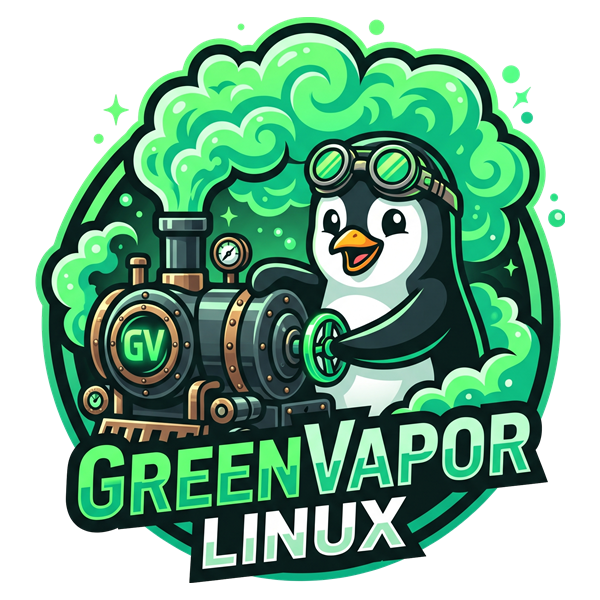
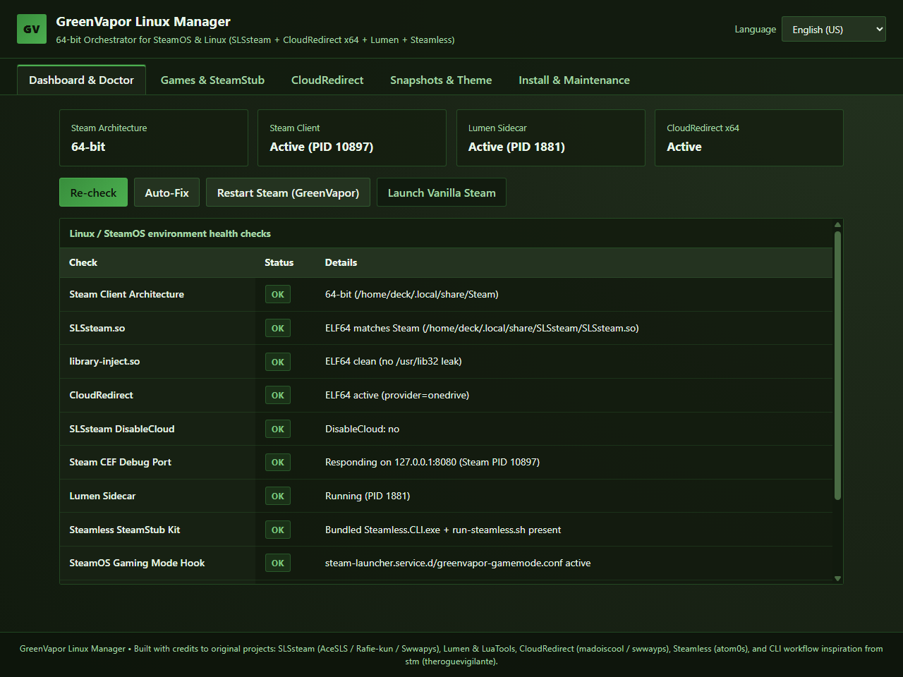
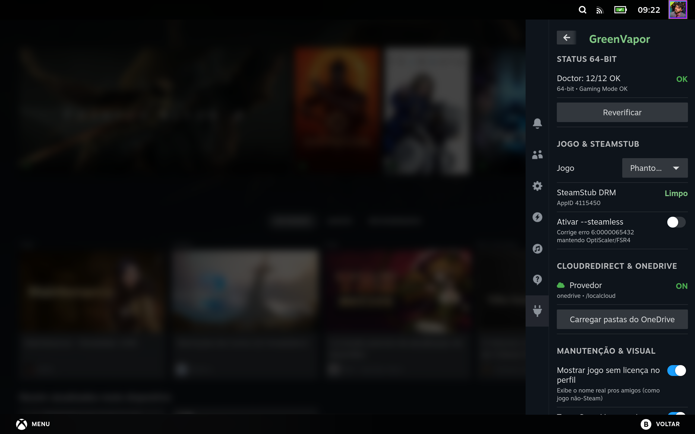

<div align="center">



# GreenVapor Linux Manager (`gvlinux`)

**Orquestrador, diagnóstico e instalador zero-root 64-bit e 32-bit (CLI + WebUI + Plugin Decky QAM) para SteamOS, Legion Go, Steam Deck, Bazzite, CachyOS e Linux.**

[English](README.md) | **Português (Brasil)** | [Capturas](#capturas-de-tela) | [Instalação](#instalação-rápida-1-comando--steamos--bazzite--linux) | [Cobertura](#cobertura-de-assinaturas-steam-ao-vivo-x64-principal--i386-suplementar) | [Comandos](#comandos-principais) | [Licença](#licença) | [Releases](https://github.com/vaporgreen/greenvapor-linux/releases/latest)

<br />

[](https://github.com/vaporgreen/greenvapor-linux/releases/latest)
[](https://github.com/vaporgreen/greenvapor-linux/releases)
[](https://github.com/vaporgreen/greenvapor-linux/actions/workflows/steam-signature-monitor.yml)
[](https://github.com/vaporgreen/greenvapor-linux/stargazers)
[](LICENSE)


</div>

---

## Capturas de tela

| Interface Visual (`gvlinux gui`) | Modo Jogo SteamOS — Plugin Decky QAM (`...`) |
| :---: | :---: |
|  |  |

---

## Instalação rápida (1 comando — SteamOS / Bazzite / Linux)

```sh
curl -fsSL https://raw.githubusercontent.com/vaporgreen/greenvapor-linux/main/install.sh | sh
```

### Instalação offline / local (usando os arquivos da pasta `dist/`)

```sh
sh install.sh ./dist/gvlinux-linux-amd64 ./dist/greenvapor-linux-bundle-x64.tar.gz ./dist/greenvapor-base-stack.tar.gz
```

### Desinstalação limpa (1 comando — preserva jogos, saves e scripts Lua)

```sh
curl -fsSL https://raw.githubusercontent.com/vaporgreen/greenvapor-linux/main/uninstall.sh | sh
```

*(Também disponível via `gvlinux purge` ou pelo botão **Desinstalar / Purge** na interface `gvlinux gui`. Passe `--full` se quiser remover também os snapshots locais em `~/.local/share/GreenVapor`.)*

### Opcional: Plugin do Decky Loader (Modo Jogo — menu `...`)

Baixe o **`GreenVapor.zip`** na [última release](https://github.com/vaporgreen/greenvapor-linux/releases/latest) e instale em **Decky Loader → Desenvolvedor → Instalar Plugin a partir de ZIP** para gerenciar o `gvlinux` pelo controle direto no Modo Jogo.

---

## Cobertura de Assinaturas Steam ao Vivo (x64 Principal + i386 Suplementar)

A cada 6 horas, [nosso monitor no GitHub Actions](.github/workflows/steam-signature-monitor.yml) baixa os manifestos oficiais 64-bit (`steam_client_steamrt64` / `steam_client_publicbeta_steamrt64`) e 32-bit (`steam_client_ubuntu12` / `steam_client_publicbeta_ubuntu12`) da Valve e valida todas as assinaturas:

| Componente | Steam Stable | Steam Public Beta | Status Upstream |
| --- | :---: | :---: | :---: |
| **`SLSsteam.so` x64** (`steamrt64`, principal) | **61 / 61** ✅ | **61 / 61** ✅ | 52/61 Stable · 41/61 Beta |
| **`cloud_redirect.so` x64** (`steamrt64`, principal) | **7 / 7** ✅ | **7 / 7** ✅ | N/A |
| **`SLSsteam.so` i386** (`ubuntu12_32`, suplementar) | **61 / 61** ✅ | **61 / 61** ✅ | 57/61 (4 `RunIPCFrame` alterados) |
| **`cloud_redirect.so` i386** (`ubuntu12_32`, suplementar) | **7 / 7** ✅ | **7 / 7** ✅ | 3/7 (`CProtoBufMsgBase` +8B) |

O `install.sh` e o `gvlinux update` selecionam automaticamente **`greenvapor-linux-bundle-x64.tar.gz`** em clientes 64-bit `steamrt64` (SteamOS, Steam Deck, Legion Go, Bazzite, Linux moderno) e **`greenvapor-linux-bundle-x86.tar.gz`** em clientes legados 32-bit (`ubuntu12_32` / híbrido `steamrt3`). Compilado com [patches/steam-beta-dual-patterns.patch](patches/steam-beta-dual-patterns.patch) e [patches/decky-cef-8080.patch](patches/decky-cef-8080.patch).

---

## O que vem incluído no pacote 64-bit

- **`gvlinux`** — binário Go ELF64 estático (~6,5 MB, zero dependências, zero root):
  - **Interface visual (`gvlinux gui`)** no tema verde escuro GreenVapor + atalho automático no menu de aplicativos do KDE/Desktop.
  - **Multidioma (`pt-BR`, `en-US`, `es-ES`)** com detecção automática de `$LANG` e troca em tempo real.
  - **Diagnóstico e Auto-Reparo 64-bit (`gvlinux doctor` / `gvlinux fix`)**:
    - 12 verificações validando arquitetura `steamrt64` vs ELF64 em `SLSsteam.so`, `library-inject.so` e `cloud_redirect.so`.
    - Detecta o vazamento upstream de `/usr/lib32` no `library-inject.so` 64-bit.
    - Detecta e remove sobras de `steam.cfg` 32-bit (`BootStrapperInhibitAll=enable`) que causam `Updater check error: 40` no Modo Jogo do SteamOS.
    - Verifica `DisableCloud: no`, porta CEF, Lumen, kit Steamless, hook do Modo Jogo do SteamOS (`steam-launcher.service.d/greenvapor-gamemode.conf`) e coexistência **Decky Loader + Lumen na porta `8080`**.
  - **Proton Launch Helper & Auto-Detector (`gvlinux proton` + WebUI)**:
    - Escaneia automaticamente jogos instalados procurando DLLs proxy locais que o Wine/Proton ignora sem `WINEDLLOVERRIDES` (`winmm.dll`, `version.dll`, `dxgi.dll`, `dinput8.dll`, `d3d12.dll`, etc.) e oferece **Auto-Fix em 1 clique**.
    - Gerenciador seguro de **`WINEDLLOVERRIDES`** e **redirecionador de executável** (pular launchers ou escolher um `.exe` alternativo em subpasta via `%command%`) preservando `--steamless`, OptiScaler/FSR4, `MANGOHUD`, etc. Atualiza ao vivo via Steam CEF.
  - **Scanner de Jogos & SteamStub v2/v3 (`gvlinux games` / `gvlinux steamless`)**: detecta executáveis protegidos com SteamStub (erro `6:0000065432`) e ativa/desativa `--steamless` sem apagar suas opções atuais.
  - **Pasta Raiz Configurável no OneDrive (`gvlinux cloud folders` / `gvlinux cloud set-folder <pasta>`)**: permite escolher `CloudRedirect`, `localcloud` ou qualquer pasta do seu OneDrive onde já estejam os saves do Windows.
  - **Presença no Perfil Steam (`gvlinux presence on|off`)**: alterna `ShowUnownedStatus` para exibir jogos sem licença no perfil/amigos como atalho não-Steam sem quebrar o CloudRedirect.
  - **Snapshots, Rollback, `steam --vanilla`, auto-atualizador SHA-256 (`gvlinux update`) e `gvlinux purge --yes`** (nunca apaga seus jogos nem seus arquivos em `stplug-in/*.lua`).
  - **Tema GreenVapor reversível para o Lumen (`gvlinux brand apply|revert`)** mantendo os créditos aos projetos originais no rodapé.

- **Bundle 64-bit (`greenvapor-linux-bundle-x64.tar.gz`)**:
  - **`cloud_redirect.so` + `cloud_redirect_cli` (x86_64)** — port 64-bit completo para `steamclient64.so` com todos os 8 módulos, `onedrive_root_folder` configurável, retry em falhas `curl 35/56` / `5xx` no OneDrive e cache de burst de 5s sob `foreignSession`.
  - **`SLSsteam.so` (x86_64)** — compilado com assinaturas duplas Steam Stable + Public Beta (`61/61`) e coexistência **Decky Loader + Lumen (CEF na porta `8080`)** dentro do `pressure-vessel` e namespaces `LD_AUDIT` secundários.
  - **`library-inject.so` (x86_64)** — versão ELF64 corrigida ([patches/library-inject-x64.cpp](patches/library-inject-x64.cpp)) validando `ELFCLASS64` para evitar que `/usr/lib32` quebre o `kde-open` / login OAuth no navegador.

---

## Comandos principais

```sh
gvlinux gui                                 # Abre a interface visual embarcada no navegador
gvlinux doctor                              # Diagnóstico completo 64-bit/32-bit (14 verificações, CLI colorido)
gvlinux fix                                 # Auto-reparo seguro (Modo Jogo, Decky 8080, Updater 40, conflitos)
gvlinux cheevo                              # Gera schemas locais de conquistas Steam faltantes (sem API key)
gvlinux catalog search "Deadpool"           # Busca jogos na Loja Steam + removidos/delistados por nome ou AppID
gvlinux catalog add 224060                  # Adiciona um jogo pelo AppID via suas fontes locais do Lumen/LuaTools
gvlinux saves backup <appid>                # Backup de saves do prefixo Proton + userdata + CloudRedirect
gvlinux saves restore <backup-id>           # Restaura um backup de saves com segurança
gvlinux support-bundle                      # Exporta .zip de diagnóstico anonimizado para suporte no Discord
gvlinux games                               # Lista jogos e detecta SteamStub v2/v3
gvlinux steamless enable <appid>            # Ativa --steamless preservando LaunchOptions
gvlinux steamless unpack <appid>            # Desembrulha SteamStub imediatamente
gvlinux proton scan [appid]                 # Auto-detecta DLLs proxy locais e .exe alternativos
gvlinux proton autofix <appid>              # Aplica automaticamente WINEDLLOVERRIDES faltantes
gvlinux proton dll add <appid> winmm        # Adiciona/remove entrada em WINEDLLOVERRIDES
gvlinux proton exe list <appid>             # Lista executáveis reais na pasta do jogo
gvlinux proton exe set <appid> <rel.exe>    # Redireciona %command% para outro .exe (ou: clear)
gvlinux cloud                               # Status do CloudRedirect e últimos logs
gvlinux cloud folders                       # Lista pastas na raiz do OneDrive
gvlinux cloud set-folder localcloud         # Define a pasta raiz de saves no OneDrive
gvlinux snapshot create "antes-update"      # Cria snapshot atômico de segurança
gvlinux rollback <snapshot-id>              # Restaura snapshot atomicamente
gvlinux brand apply                         # Aplica tema GreenVapor reversível + créditos no Lumen
gvlinux presence on                         # Mostra jogos sem licença no perfil Steam (como não-Steam)
gvlinux update                              # Verifica e instala a última release do GreenVapor Linux (SHA-256)
gvlinux update --stack                      # Também atualiza Lumen & LuaTools mantendo Update Shield + tema
gvlinux vanilla                             # Abre Steam original sem hooks (ou: steam --vanilla)
gvlinux purge --yes                         # Restaura Steam original preservando jogos e stplug-in
```

## Build a partir do código-fonte

```sh
./build-linux.sh
```

Executa todos os testes unitários (`go test -v ./...`) e gera o binário estático `CGO_ENABLED=0` ELF64 em `dist/gvlinux-linux-amd64`.

---

## Licença

**Source-Available — Todos os Direitos Reservados (Somente Uso Pessoal).** Veja [LICENSE](LICENSE) e [NOTICE](NOTICE).

- Usuários finais podem baixar, auditar, compilar e usar o `gvlinux` gratuitamente para **uso pessoal e não comercial**.
- É obrigatória **autorização prévia por escrito** de `vaporgreen` (`leorobles`) para copiar, portar, modificar, redistribuir ou usar ferramentas automatizadas / IA para extrair ou reimplementar qualquer código-fonte, patch, script ou binário deste repositório em outro projeto. Dar créditos isoladamente não concede permissão de cópia ou derivação.

## Créditos

Este projeto interopera com e dá créditos aos projetos upstream originais da comunidade:
- **SLSsteam** — AceSLS / Rafie-kun / Swwapys
- **Lumen & LuaTools** — comunidade LuaTools / Rafie-kun / Swwapys
- **CloudRedirect** — madoiscool / swwayps
- **Steamless** — atom0s
